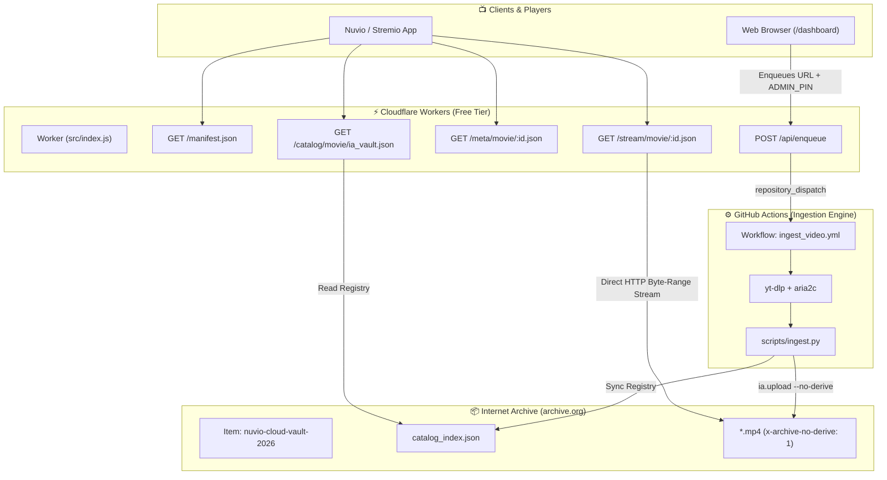

# Nuvio Cloud Vault 🎬⚡

> **Zero-Cost Automated Video Ingestion & Nuvio / Stremio Streaming Addon System**  
> Powered by **Internet Archive (`archive.org`)**, **GitHub Actions**, and **Cloudflare Workers**.

---

## 🏛️ System Architecture



---

## ✨ Features

- **Zero-Cost Storage & Bandwidth:** Leverages Internet Archive's free, permanent cloud hosting with fast HTTP byte-range direct streaming.
- **Immediate Streaming (`--no-derive`):** Ingested videos bypass Archive.org's slow server-side transcoding queue, making files immediately playable upon upload completion.
- **Automated High-Speed Ingestion:** GitHub Actions runs `yt-dlp` combined with `aria2c` (16 concurrent connections) to pull videos from YouTube, direct MP4/MKV links, and 1000+ supported sites.
- **Nuvio & Stremio Addon Protocol Compliance:** Full support for `/manifest.json`, `/catalog/movie/ia_vault.json`, `/meta/movie/:id.json`, and `/stream/movie/:id.json` with strict CORS enabled.
- **Integrated Web Dashboard (`/dashboard`):** Minimalist dark-mode UI with password/PIN protection to paste links, override titles/posters, and trigger uploads.
- **Resilient Fallback:** If `catalog_index.json` is missing or being created, the Cloudflare Worker seamlessly falls back to the Internet Archive Metadata API.

---

## 🔑 Prerequisites & API Keys

Before starting, prepare the following credentials:

| Credential | Purpose | Where to Get |
|---|---|---|
| `IA_ACCESS_KEY` & `IA_SECRET_KEY` | Authenticates video & catalog uploads to Internet Archive S3 API | [archive.org/account/s3.php](https://archive.org/account/s3.php) |
| `IA_ITEM_ID` | The unique identifier for your Archive.org item collection | Choose any name (e.g. `nuvio-cloud-vault-2026`) |
| `ADMIN_PIN` | Secret PIN securing the `/dashboard` enqueue form | Set any custom password (e.g. `vault_secret_987`) |
| `GITHUB_PAT` | Personal Access Token used by Worker to trigger GitHub Actions | [github.com/settings/tokens](https://github.com/settings/tokens) (Select **Repo** & **Workflow** scopes) |
| `CLOUDFLARE_API_TOKEN` *(Optional)* | Deploys Worker automatically via GitHub Actions CI/CD | [dash.cloudflare.com/profile/api-tokens](https://dash.cloudflare.com/profile/api-tokens) ("Edit Cloudflare Workers" template) |
| `CLOUDFLARE_ACCOUNT_ID` *(Optional)* | Cloudflare Account ID for Wrangler | Cloudflare Dashboard > Workers & Pages (Right sidebar) |

---

## 🚀 Quickstart & Deployment

### Step 1: Initialize Git Repository
```bash
cd /workspace/nuvio-media-server

git init
git add .
git commit -m "feat: initial nuvio media server scaffold"
```

Create a new repository on GitHub (e.g. `https://github.com/<your-username>/nuvio-media-server`) and push your branch:
```bash
git remote add origin https://github.com/<your-username>/nuvio-media-server.git
git branch -M main
git push -u origin main
```

### Step 2: Run Interactive Setup
Execute `./setup.sh`. It will prompt you for your keys and automatically configure GitHub Secrets and Cloudflare Worker secrets:
```bash
./setup.sh
```

### Step 3: Deploy the Cloudflare Worker
Deploy the worker to Cloudflare's global edge network:
```bash
npx wrangler deploy
```

Once deployed, Wrangler outputs your Worker URL:
```text
Published nuvio-media-server (X.XX sec)
  https://nuvio-media-server.<your-subdomain>.workers.dev
```

---

## 📺 Adding to Nuvio / Stremio

1. Open **Nuvio** or **Stremio**.
2. Navigate to the **Addons** tab.
3. In the "Add Addon URL" search bar, paste:
   ```text
   https://nuvio-media-server.<your-subdomain>.workers.dev/manifest.json
   ```
4. Click **Install**.
5. Go to **Discover / Catalog** -> Select **Cloud Vault Archive**. Your uploaded movies will appear with full posters and instant direct streaming!

---

## 📥 Ingesting Videos

### Method A: Web Dashboard (Recommended)
1. Open `https://nuvio-media-server.<your-subdomain>.workers.dev/dashboard` in any browser.
2. Enter your **Video Source URL** (YouTube, Direct MP4/MKV link, or any yt-dlp supported source).
3. (Optional) Provide a **Custom Title**, **IMDb ID** (e.g. `tt0111161`), and **Poster URL**.
4. Enter your **Admin PIN**.
5. Click **Trigger Cloud Ingestion**.
6. The Worker fires a `repository_dispatch` event to GitHub Actions, which executes the download, tags the metadata, and uploads to Archive.org in the background.

### Method B: GitHub Actions UI (Manual Trigger)
1. Go to your repository on GitHub.
2. Click **Actions** > **Ingest Video to Cloud Vault**.
3. Click **Run workflow**.
4. Fill in `video_url` and optional metadata fields, then click **Run workflow**.

---

## 📁 Repository Structure

```text
.
├── .github/
│   └── workflows/
│       ├── ingest_video.yml     # Automated download & Archive.org uploader
│       └── deploy_worker.yml    # Auto-deploy Worker on git push to main
├── src/
│   └── index.js                 # Complete Cloudflare Worker (Addon + Dashboard + API)
├── scripts/
│   └── ingest.py                # Python ingestion engine (yt-dlp, aria2c, internetarchive)
├── package.json                 # Worker configuration & scripts
├── wrangler.toml                # Wrangler Cloudflare Workers manifest
├── requirements.txt             # Python dependencies (yt-dlp, internetarchive, requests)
├── setup.sh                     # Interactive one-shot configuration CLI
├── .gitignore                   # Protects credentials and temporary files
└── README.md                    # Project documentation & reference
```

---

## 📡 API & Protocol Endpoints

| Method | Endpoint | Description |
|---|---|---|
| `GET` | `/manifest.json` | Nuvio / Stremio Addon manifest |
| `GET` | `/catalog/movie/ia_vault.json` | Returns all available videos in the vault |
| `GET` | `/catalog/movie/ia_vault/search=:query.json` | Filters catalog by search term |
| `GET` | `/meta/movie/:id.json` | Detailed metadata for a specific movie |
| `GET` | `/stream/movie/:id.json` | Direct Archive.org HTTP byte-range stream link |
| `GET` | `/dashboard` | Interactive Web Dashboard |
| `POST` | `/api/enqueue` | Webhook receiver triggering GitHub Actions workflow |
| `GET` | `/api/catalog` | JSON endpoint returning parsed vault items |

---

## 🛡️ License
MIT License. Free to use, adapt, and deploy.
